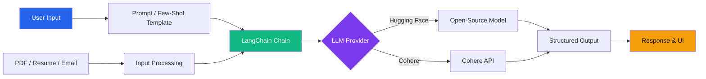
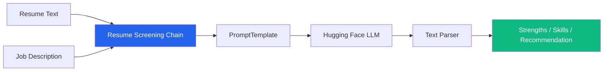
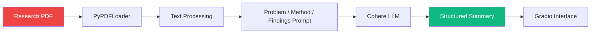
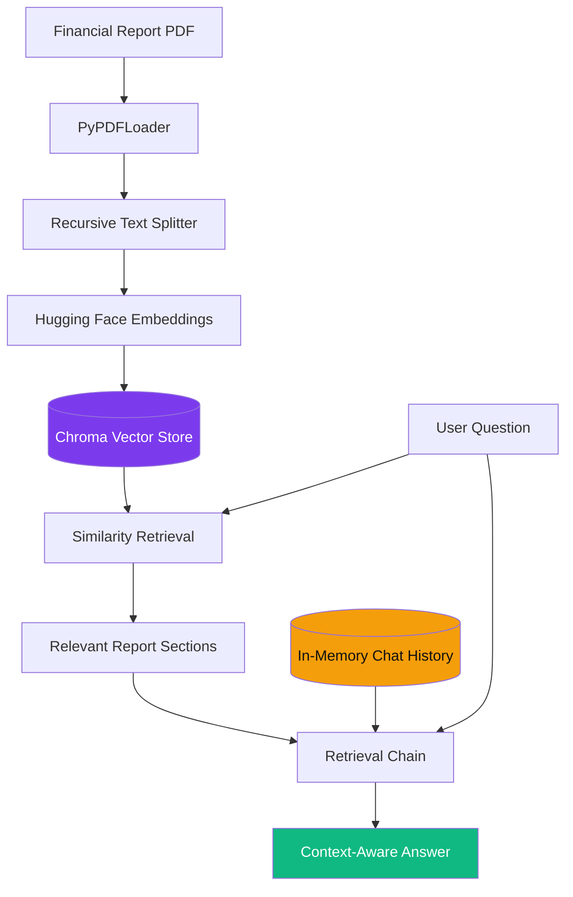
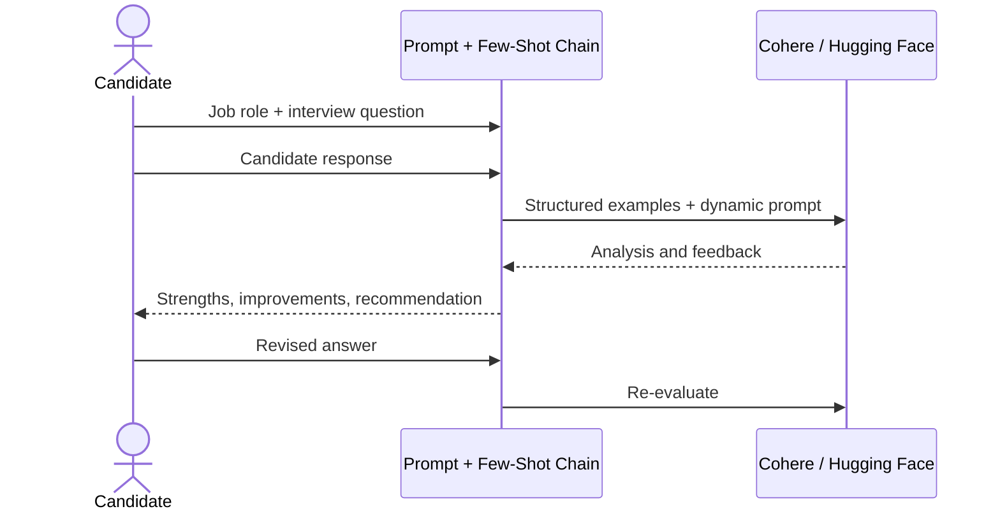
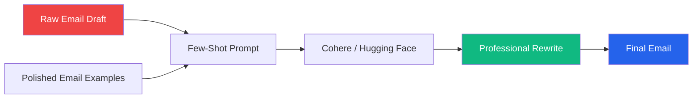

<div align="center">

# LangChain Projects

**A collection of practical AI applications built with LangChain**

[](https://colab.research.google.com/github/Prktriesitout/Langchain_Projects)
[](#-quick-start)
[](https://python.langchain.com/)
[](#-license)

[Projects](#-project-gallery) · [Architecture](#-system-architecture) · [Quick Start](#-quick-start) · [Tech Stack](#-tech-stack)

</div>

---

## ✨ Overview

This repository explores real-world AI assistants using LangChain orchestration, prompt engineering, document retrieval, conversation memory, and LLM integrations.



## 🧭 Project Gallery

| # | Project | Use Case | Core Technique | Open |
|---|---|---|---|---|
| 01 | **HR Resume Screener** | Compare candidate resumes with job descriptions and produce shortlist recommendations | Prompt templates, Hugging Face, structured output | [](./Project1.ipynb) |
| 02 | **Research Paper Summarizer** | Transform PDF papers into Problem, Method, and Findings summaries | PDF loaders, text splitting, prompt chains, Gradio | [](./Project2.ipynb) |
| 03 | **Financial Report Analyst** | Answer contextual questions across financial PDF reports | RAG, vector search, retrieval chains, conversation memory | [](./Project3.ipynb) |
| 04 | **AI Interview Coach** | Evaluate answers and provide realistic, structured interview feedback | Few-shot prompting, role-aware coaching | [](./Project4.ipynb) |
| 05 | **Email Tone Improver** | Rewrite abrupt or unprofessional drafts into polished emails | Few-shot prompting, prompt chains | [](./Project5.ipynb) |

---

## 🏗️ System Architecture

### 01 — Resume screening pipeline



### 02 — PDF summarization pipeline



### 03 — RAG and memory pipeline



### 04 — Interview coaching loop



### 05 — Email rewriting pipeline



---

## 🚀 Quick Start

### 1. Create a virtual environment

```bash
python -m venv .venv
source .venv/bin/activate        # macOS / Linux
# .venv\Scripts\activate         # Windows
```

### 2. Install notebook dependencies

```bash
pip install -U notebook
pip install -U langchain langchain-core langchain-community langchain-huggingface
pip install -U langchain-cohere langchain-chroma langchain-text-splitters
pip install -U transformers huggingface_hub accelerate pypdf gradio rich
```

### 3. Configure API credentials

Choose the credentials required by the notebook you run:

```bash
export HUGGINGFACEHUB_API_TOKEN="your_hugging_face_token"
export COHERE_API_KEY="your_cohere_api_key"
```

> When using Google Colab, store these values in **Colab Secrets** rather than placing keys directly in notebook code.

### 4. Launch Jupyter

```bash
jupyter notebook
```

Open any project from the table above and run the cells in order.

### ☁️ Run in Google Colab

Each notebook includes a Colab badge. Alternatively, use this link format:

```text
https://colab.research.google.com/github/Prktriesitout/Langchain_Projects/blob/main/Project1.ipynb
```

Replace `Project1.ipynb` with the notebook you want to run.

---

## 🧰 Tech Stack

| Category | Tools |
|---|---|
| **Orchestration** | LangChain, LangChain Core, LangChain Classic |
| **Models** | Hugging Face, Cohere |
| **Prompting** | PromptTemplate, FewShotPromptTemplate |
| **Document Processing** | PyPDFLoader, RecursiveCharacterTextSplitter |
| **Retrieval** | Hugging Face Embeddings, Chroma vector store |
| **Memory** | InMemoryChatMessageHistory |
| **Output** | StrOutputParser, structured prompt formats |
| **Interfaces** | Jupyter Notebook, Google Colab, Gradio |
| **Utilities** | Transformers, Accelerate, Rich |

---

## 🔐 Environment Variables

| Variable | Used for |
|---|---|
| `HUGGINGFACEHUB_API_TOKEN` | Hugging Face model and endpoint access |
| `COHERE_API_KEY` | Cohere chat model access |

Never commit API keys or secrets to notebooks or Git.

## 🗂️ Repository Layout

```text
Langchain_Projects/
├── README.md
├── Project1.ipynb   # HR resume screening assistant
├── Project2.ipynb   # PDF research paper summarizer
├── Project3.ipynb   # Financial report RAG analyst
├── Project4.ipynb   # AI interview coach
└── Project5.ipynb   # Email tone improver
```

## 🤝 Contributing

Contributions are welcome. Good starting points include:

- Migrating notebooks into reusable Python modules
- Adding automated tests for prompt and chain outputs
- Introducing streaming and configurable model providers
- Building unified Gradio or Streamlit interfaces
- Comparing open-source and hosted embedding models

## 📄 License

Add a license file to define how others may use, modify, and distribute this project.
